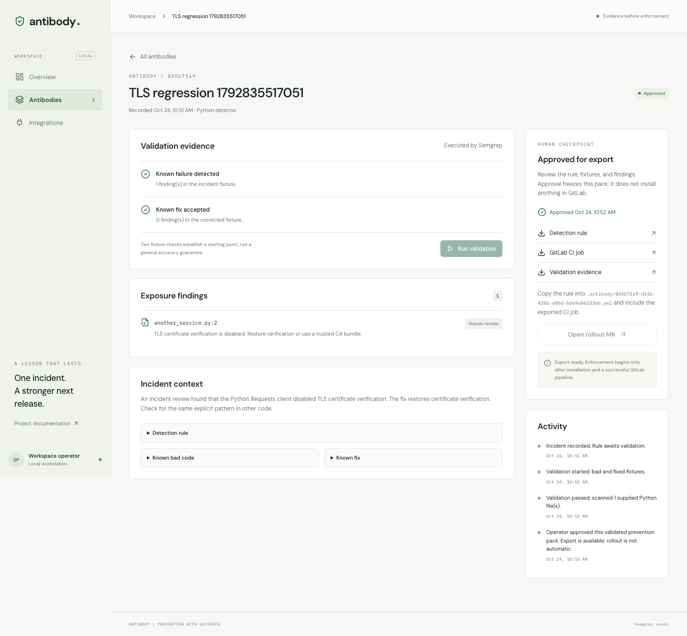

# Antibody

**Turn lessons from one bug into tested prevention across your GitLab projects.**

Antibody turns a confirmed incident into a reviewable Semgrep detector. Validate the known failure and its fix, inspect matches in supplied source, approve the evidence, and export or propose a GitLab prevention check.

## What works

- Persistent incident history and validation evidence in SQLite.
- Real Semgrep scans of bad/fixed Python fixtures, up to eight additional examples, and uploaded or GitLab repository source.
- Failed, running, validated and approved states with enforced approval gates.
- Rule, evidence and GitLab CI downloads.
- Pinned repository commits, source links and explicit skipped-file coverage.
- Separate detector revisions, stable detail URLs and interrupted-run recovery.
- Responsive desktop/mobile workspace, intentional empty/loading/error states.
- Server-side GitLab adapters for rollout MRs and real Duo synthesis sessions.
- Maintained Python Requests TLS detector as a labelled starting example.

**Integration status:** A real rollout MR has been created in the configured GitLab project. GitLab CI is blocked by account verification, and Duo catalog creation is blocked by namespace permissions. Local scanner execution is verified. Rule synthesis from Duo currently opens a reviewable session; importing its proposed YAML remains an explicit operator step. No fabricated integration success or detector-accuracy scores are displayed.

## Interface



## Local setup

Requirements: Node.js 24+, npm, Python 3.11+ and [uv](https://docs.astral.sh/uv/).

```bash
./scripts/setup.sh
cp .env.example .env.local
npm run local
```

Open http://127.0.0.1:3100/app. Start in an empty workspace, select **New antibody**, and optionally choose **Use TLS example** to fill editable fixtures. Upload Python files if you want exposure results. Create the draft, run validation, inspect results and approve the pack.

Google Cloud, a billing account and a credit card are not required for local operation. `npm run local` binds to your computer only, selects SQLite persistence and checks the scanner installation. Set `PORT` to change the local port. It loads `.env.local` and, if no explicit `GITLAB_TOKEN` is set, attempts to read your existing GitLab sign-in through Git's credential helper. Credentials stay in process memory. Local scanning and exports work even without GitLab credentials.

The example is not prepopulated history. Uploaded fixtures are actually scanned. No incident code is executed.

## Environment

| Variable                | Purpose                                                                 |
| ----------------------- | ----------------------------------------------------------------------- |
| ACCESS_TOKEN            | Required for protected remote access; HTTP Basic username is `antibody` |
| ANTIBODY_DATA_DIR       | Persistent SQLite directory; default `.data`                            |
| SEMGREP_BIN             | Local executable; default `.venv/bin/semgrep`                           |
| GITLAB_URL              | HTTPS GitLab origin; default https://gitlab.com                         |
| GITLAB_TOKEN            | Server-only token with required repository/API permissions              |
| GITLAB_PROJECT_ID       | Project to receive rollout merge requests and Duo sessions              |
| GITLAB_FLOW_CONSUMER_ID | Enabled AI Catalog flow consumer identifier                             |

Never commit credentials or paste them into an incident. Remote access requires HTTPS. Do not expose an unauthenticated deployment.

## GitLab Duo integration

1. Register for the hackathon and complete GitLab contributor onboarding.
2. Create a custom flow from `.gitlab/flows/incident-to-rule.yml` in your authorized namespace.
3. Enable the flow for the selected project and obtain its catalog consumer ID.
4. Configure the server environment and restart Antibody.
5. Start a Duo session from an incident. Inspect the proposed detector and fixtures in GitLab.
6. Import reviewed YAML into a new draft; execute local validation before approval.

The flow definition follows the documented registry v1 structure. Namespace-specific creation, tool permissions and live execution still require validation. See [GitLab custom flows](https://docs.gitlab.com/user/duo_agent_platform/flows/custom/) and [Flows API](https://docs.gitlab.com/api/duo_agent_platform_flows/).

## Rollout

Approved packs offer three downloads: detector YAML, CI job YAML and evidence JSON. Place the detector at the path named in the exported CI job and include that job in your pipeline.

With GitLab credentials configured, **Open rollout MR** creates the required files and root CI include as a reviewable merge request. Antibody never merges it automatically. Review job stages, branch rules and merge settings before claiming enforcement. This version does not create centrally enforced group policies.

## Testing

```bash
npm test
npm run typecheck
npm run build
npx playwright install chromium
npm run dev -- --port 3100
# In another terminal:
npx playwright test
```

Engine tests run the real installed Semgrep binary. Browser tests exercise incident creation, source upload, actual validation, approval, export, refresh and mobile navigation. Tests create clearly named local records; use a separate ANTIBODY_DATA_DIR for an isolated test workspace.

## Deployment

```bash
docker build -t antibody .
docker run --rm -p 8080:8080 --env-file .env.local \
  -v antibody-data:/app/.data antibody
```

Provide ACCESS_TOKEN and HTTPS when exposing it beyond localhost. The application is single-operator software. The Dockerfile is prepared but container execution depends on an available Docker runtime.

**Google Cloud Run:** compatible container interface, but use `ANTIBODY_STORE=firestore` for durable cloud persistence. The adapter uses runtime service-account credentials. Live cloud persistence must still be verified in the selected project. No cloud resources have been provisioned.

## Repository structure

```text
src/app/                  Marketing, workspace and HTTP routes
src/components/           Workspace, incident creation and shared UI
src/lib/model.ts          Input validation and domain types
src/lib/engine.ts         Real scanner execution and evidence transitions
src/lib/store.ts          SQLite / Firestore persistence
src/lib/gitlab.ts         Rollout and Duo REST adapters
.gitlab/flows/            Duo custom flow definition
.gitlab-ci.yml            Project verification pipeline
scripts/setup.sh          Reproducible local setup
tests/                    Engine and browser tests
docs/                     Product model, architecture and build log
```

## Limits

One supported language and one supplied rule per antibody. Two fixtures do not establish detector precision; broader positive/negative evaluation is required. Matches require human assessment. No autonomous source repair, incident attribution, multi-tenant accounts, durable background queue, or org-wide policy rollout is claimed. See [architecture](docs/architecture.md).

## Hackathon

Intended entry: GitLab Life After Code, Start Fresh / Supervised. The central sponsor integration is Duo incident-to-rule synthesis, followed by executable validation and a human-reviewed prevention MR. A successful live Duo run and real GitLab enforcement demonstration remain required before calling it submission-ready.

## License

MIT. See LICENSE.

### Confirmed-project cloud deployment

`scripts/deploy-cloud-run.sh PROJECT_ID REGION` prepares a runtime service account, Firestore, protected secrets, container build and Cloud Run service. It requires authenticated gcloud and glab. It creates billable cloud resources only in the explicit project argument. It never prints tokens; the generated workspace password is stored in a private local configuration file. Public landing access does not bypass the application access gate. The script is prepared; the selected target is `gather-483dd`, whose billing must be enabled before execution. The runtime uses a dedicated `antibody` database with database-scoped IAM.

## Live integration status

GitLab source is synchronized to https://gitlab.com/antibody-group1/Antibody-project.
A real, unmerged rollout was created at https://gitlab.com/antibody-group1/Antibody-project/-/merge_requests/1.
GitLab accepted the CI configuration as valid, but the first pipeline was blocked because the user account is not verified. Duo catalog creation returned a permission/resource error; synthesis is not yet live-verified. Google Cloud project `gather-483dd` is accessible but billing is disabled; no cloud deployment is claimed.

## Local backup and recovery

`npm run backup -- /absolute/path/new-backup.sqlite` creates a consistent SQLite snapshot, checks integrity and uses owner-only file permissions. Backups contain incident source; keep them private. Existing files are never overwritten.

`npm run restore -- /absolute/path/backup.sqlite /absolute/path/new-data-directory` verifies the backup and restores into a new directory. Start with `ANTIBODY_DATA_DIR=/absolute/path/new-data-directory npm run local` to inspect the copy. Keep the original database until verification is complete. Cloud Firestore backup is outside this local tool's scope.

## Review a detector revision

Open an incident and choose **Revise / import reviewed proposal**. Paste the reviewed rule and fixture changes, add safe/unsafe examples, and save a new draft. Original approval/evidence is retained. Every fixture must pass validation before the revised pack can be approved.

Repository source uses the documented [GitLab repository APIs](https://docs.gitlab.com/api/repositories/) and [file APIs](https://docs.gitlab.com/api/repository_files/). Local limits are disclosed in the interface; a partial scan is not proof that a repository is safe.
